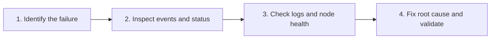

# Kubernetes Troubleshooting Guide

A practical, command-first runbook for the most common Kubernetes node and pod failures — what each error means, what to run first, and how to fix the root cause instead of restarting and hoping.

> [!NOTE]
> `CreateContainerError`, `CreateContainerConfigError`, `ImagePullBackOff`, `RunContainerError`, and `OOMKilled` are **not interchangeable**. Their remediation differs, and blindly restarting pods is the Kubernetes equivalent of turning a broken server off and on again while hoping the laws of physics have changed.

---

## Table of Contents

- [Issue Overview](#issue-overview)
- [The Troubleshooting Workflow](#the-troubleshooting-workflow)
- [Commands Worth Memorizing](#commands-worth-memorizing)
- [1. CreateContainerError](#1-createcontainererror)
- [2. CreateContainerConfigError](#2-createcontainerconfigerror)
- [3. ImagePullBackOff](#3-imagepullbackoff)
- [4. RunContainerError](#4-runcontainererror)
- [5. OOMKilled](#5-oomkilled)
- [Quick Reference: Symptom to Remediation](#quick-reference-symptom-to-remediation)
- [Reusable Diagnostic Command Sequence](#reusable-diagnostic-command-sequence)

---

## Issue Overview

| # | Issue | What it means | First command to run |
|---|-------|---------------|----------------------|
| 1 | `Node NotReady` | Node cannot report healthy status to the control plane | `kubectl describe node <node>` |
| 2 | `DiskPressure` | Node disk or inode availability is critically low | `kubectl describe node <node>` |
| 3 | `CreateContainerError` | Container creation failed, often due to mounts, permissions, or runtime configuration | `kubectl describe pod <pod> -n <ns>` |
| 4 | `CreateContainerConfigError` | Kubernetes cannot construct the container configuration, often due to missing Secrets or ConfigMaps | `kubectl describe pod <pod> -n <ns>` |
| 5 | `ImagePullBackOff` | Kubernetes cannot pull the container image | `kubectl describe pod <pod> -n <ns>` |
| 6 | `RunContainerError` | The container runtime failed to start the container | `kubectl describe pod <pod> -n <ns>` |
| 7 | `OOMKilled` | The container was terminated after exceeding its memory limit or due to system-level out-of-memory conditions | `kubectl describe pod <pod> -n <ns>` |

> Detailed runbooks below cover the five container-level failures (#3–#7). For node-level issues (#1–#2), start with the node health commands in [Commands Worth Memorizing](#commands-worth-memorizing).

---

## The Troubleshooting Workflow



| Step | Action | Commands |
|------|--------|----------|
| 1 | Identify the failure | `kubectl get nodes` · `kubectl get pods -A` |
| 2 | Inspect events and status | `kubectl describe pod/node` |
| 3 | Check logs and node health | `kubectl logs` · `journalctl` · `df -h` · `free -h` |
| 4 | Fix the root cause and validate | Confirm pod recovery, node readiness, and application health |

---

## Commands Worth Memorizing

```bash
# Cluster and node health
kubectl get nodes -o wide
kubectl get pods -A
kubectl get events -A --sort-by=.lastTimestamp

# Pod diagnostics
kubectl describe pod <pod> -n <namespace>
kubectl logs <pod> -n <namespace> --previous

# Node resource health (run on the node)
df -h
df -i
free -h
sudo journalctl -u kubelet --since "30 min ago"
```

---

## 1. CreateContainerError

**Meaning:** Kubernetes has attempted to create the container, but the container runtime failed during creation.

Common causes include invalid mount paths, filesystem permissions, conflicting container settings, or runtime-level errors.

### Step 1 — Inspect the pod

```bash
kubectl describe pod <pod> -n <namespace>
kubectl get pod <pod> -n <namespace> -o yaml
```

Check the **Events** section, container state, volume mounts, and error message.

### Step 2 — Identify the runtime error

```bash
kubectl get events -n <namespace> --sort-by=.lastTimestamp
kubectl logs <pod> -n <namespace> --all-containers
```

Container logs may not exist if the container never started. In that case, rely on Events and, when necessary, node runtime logs.

### Step 3 — Correct the root cause

| Cause | Fix |
|-------|-----|
| Invalid mount | Correct the volume and mount path |
| Permission denied | Verify ownership, security context, and filesystem permissions |
| Runtime error | Inspect kubelet and container runtime logs on the affected node |
| Invalid container configuration | Correct the workload specification |

Example node-level diagnostics:

```bash
sudo journalctl -u kubelet --since "30 minutes ago"
sudo crictl ps -a
sudo crictl logs <container-id>
```

> [!TIP]
> Use `crictl` on the affected node if it is installed and configured for the active container runtime.

---

## 2. CreateContainerConfigError

**Meaning:** Kubernetes cannot prepare the container configuration required to start the container. Typical causes include missing ConfigMaps, missing Secrets, references to nonexistent keys, or invalid environment-variable references.

### Step 1 — Inspect the exact error

```bash
kubectl describe pod <pod> -n <namespace>
kubectl get pod <pod> -n <namespace> -o yaml
```

Look for messages such as `configmap not found`, `secret not found`, or a missing required key.

### Step 2 — Check referenced resources

```bash
kubectl get configmap -n <namespace>
kubectl get secrets -n <namespace>
kubectl get deployment <deployment> -n <namespace> -o yaml
```

Confirm that resource names, namespaces, and key names match the workload configuration.

### Step 3 — Fix the missing or incorrect reference

For example, if the pod expects a ConfigMap called `app-config`:

```bash
kubectl get configmap app-config -n <namespace>
kubectl describe configmap app-config -n <namespace>
```

Create or correct the resource through your approved deployment process. If a Deployment template must change, update it through Helm, GitOps, or the source manifest rather than patching a managed pod.

### Step 4 — Verify recovery

```bash
kubectl get pods -n <namespace> -w
kubectl describe pod <new-pod> -n <namespace>
```

> [!IMPORTANT]
> A missing ConfigMap or Secret will not be fixed by repeatedly deleting the pod. Kubernetes will recreate the same failure until the configuration is corrected.

---

## 3. ImagePullBackOff

**Meaning:** Kubernetes cannot download the container image from the registry. Kubernetes retries with increasing delays, so repeatedly restarting the pod is not the solution.

### Step 1 — Read the image-pull error

```bash
kubectl describe pod <pod> -n <namespace>
```

| Error message | Likely cause |
|---------------|--------------|
| `manifest unknown` | Image tag or digest does not exist |
| `unauthorized` | Registry authentication failed |
| `no basic auth credentials` | Registry credentials are missing |
| `dial tcp` / `i/o timeout` | Network, DNS, firewall, or registry connectivity issue |
| `x509: certificate signed by unknown authority` | Registry TLS trust issue |

### Step 2 — Verify the configured image

```bash
kubectl get pod <pod> -n <namespace> -o jsonpath='{.spec.containers[*].image}'
kubectl get deployment <deployment> -n <namespace> -o yaml
```

Confirm the registry hostname, repository, image tag, and digest.

### Step 3 — Check registry credentials

```bash
kubectl get pod <pod> -n <namespace> -o jsonpath='{.spec.imagePullSecrets[*].name}'
kubectl get secrets -n <namespace>
```

Verify that the referenced pull Secret exists in the same namespace and has the correct registry credentials.

### Step 4 — Correct the issue

- **Wrong tag:** update the image reference.
- **Missing credentials:** configure a valid `imagePullSecret` or the platform's approved registry authentication.
- **Network failure:** verify DNS resolution, registry reachability, firewall rules, and proxy settings from the affected node.
- **TLS failure:** correct the registry certificate trust configuration.

### Step 5 — Validate

```bash
kubectl get pods -n <namespace> -w
kubectl describe pod <pod> -n <namespace>
```

If the image reference or pod template was updated, confirm that the replacement pod uses the corrected configuration.

---

## 4. RunContainerError

**Meaning:** The container runtime encountered an error while attempting to start the container. Unlike `ImagePullBackOff`, the image may already be available locally.

Common causes include an invalid entrypoint or command, missing executable, incompatible runtime configuration, or filesystem and permission problems.

### Step 1 — Inspect the container's current and previous state

```bash
kubectl get pod <pod> -n <namespace> -o yaml
kubectl describe pod <pod> -n <namespace>
```

Check `command`, `args`, `lastState`, `exitCode`, and the **Events** section.

### Step 2 — Retrieve application logs if available

```bash
kubectl logs <pod> -n <namespace> -c <container>
kubectl logs <pod> -n <namespace> -c <container> --previous
```

`--previous` is useful when a previous container instance terminated and its logs remain available.

### Step 3 — Inspect the workload specification

```bash
kubectl get deployment <deployment> -n <namespace> -o yaml
```

Check:

- [ ] The configured executable exists in the image
- [ ] `command` and `args` are correct
- [ ] Mounted files and directories exist
- [ ] The container's security context allows the required operations
- [ ] Required environment variables and runtime settings are correct

### Step 4 — Check the affected node if the error points to the runtime

First identify the node:

```bash
kubectl get pod <pod> -n <namespace> -o wide
```

On that node, inspect:

```bash
sudo journalctl -u kubelet --since "30 minutes ago"
sudo crictl ps -a
sudo crictl logs <container-id>
```

Use the logs that match the actual failure. For example, an invalid executable requires a different fix from a container-runtime failure.

### Step 5 — Correct and validate

Update the workload manifest or image, then verify:

```bash
kubectl rollout status deployment/<deployment> -n <namespace>
kubectl get pods -n <namespace> -o wide
```

> [!NOTE]
> For StatefulSets or DaemonSets, use the corresponding controller and rollout checks instead of assuming every workload is a Deployment.

---

## 5. OOMKilled

**Meaning:** The container was terminated by an out-of-memory mechanism. A common cause is exceeding its memory limit, but node-level memory exhaustion can also cause OOM kills.

> [!WARNING]
> Exit code `137` alone does not prove that the container was OOM-killed.

### Step 1 — Confirm the termination reason

```bash
kubectl describe pod <pod> -n <namespace>
```

Or inspect the last termination state directly:

```bash
kubectl get pod <pod> -n <namespace> -o jsonpath='{range .status.containerStatuses[*]}{.name}{" reason="}{.lastState.terminated.reason}{" exitCode="}{.lastState.terminated.exitCode}{"\n"}{end}'
```

Look for `reason=OOMKilled`.

### Step 2 — Check the container's memory configuration

```bash
kubectl get pod <pod> -n <namespace> -o yaml
```

Find the container's resource settings:

```yaml
resources:
  requests:
    memory: "512Mi"
  limits:
    memory: "1Gi"
```

These values are illustrative, not recommended settings for every application. The actual limit must be based on the workload's memory consumption.

### Step 3 — Check actual memory usage

```bash
kubectl top pod <pod> -n <namespace> --containers
kubectl top nodes
```

These commands require the Kubernetes Metrics API to be available. Current metrics may not show the peak usage immediately before a crash, so also inspect historical monitoring data if available.

### Step 4 — Determine the root cause

| Root cause | Indicator |
|------------|-----------|
| **Memory limit too low** | The application legitimately needs more memory than its configured limit |
| **Memory leak** | Usage steadily increases over time |
| **Unexpected workload spike** | A large request, batch operation, or traffic burst increases memory consumption |
| **Node memory pressure** | Multiple workloads compete for available node memory |

If node-level OOM is suspected, inspect the affected node:

```bash
sudo journalctl -k --since "30 minutes ago" | grep -i -E 'oom|out of memory|killed process'
sudo journalctl -u kubelet --since "30 minutes ago"
```

### Step 5 — Apply the appropriate fix

- Increase the memory limit when evidence shows that the workload needs more memory and the node has sufficient capacity.
- Adjust the memory request to reflect realistic consumption and improve scheduling decisions.
- Investigate memory leaks or excessive caching.
- Optimize application concurrency, batch sizes, or memory-intensive operations.
- If the node is under memory pressure, investigate overall node capacity and competing workloads instead of increasing every pod's limit.

### Step 6 — Verify recovery

```bash
kubectl get pods -n <namespace> -w
kubectl top pod <pod> -n <namespace> --containers
kubectl describe pod <pod> -n <namespace>
```

Confirm that restarts stop, memory usage stabilizes, and the application passes its health checks. Kubernetes memory limits are enforced by the operating system, so merely restarting the container will not fix an underlying memory problem.

---

## Quick Reference: Symptom to Remediation

| Failure | First thing to check | Typical fix |
|---------|----------------------|-------------|
| `CreateContainerError` | Runtime error and volume mounts | Correct mounts, permissions, or runtime configuration |
| `CreateContainerConfigError` | Missing Secret, ConfigMap, or key | Fix configuration references |
| `ImagePullBackOff` | Image name, registry access, credentials | Correct image reference or registry access |
| `RunContainerError` | Entrypoint, command, runtime logs | Correct startup configuration or runtime issue |
| `OOMKilled` | Last termination state, memory limits, metrics | Address memory usage, limits, or node capacity |

---

## Reusable Diagnostic Command Sequence

Run this first whenever a pod fails:

```bash
NS=<namespace>
POD=<pod>

# 1. Current status and node placement
kubectl get pod "$POD" -n "$NS" -o wide

# 2. Events and diagnostic messages
kubectl describe pod "$POD" -n "$NS"

# 3. Container termination details
kubectl get pod "$POD" -n "$NS" -o yaml

# 4. Current logs
kubectl logs "$POD" -n "$NS" --all-containers

# 5. Previous container logs, if available
kubectl logs "$POD" -n "$NS" --all-containers --previous

# 6. Recent namespace events
kubectl get events -n "$NS" --sort-by=.lastTimestamp
```

---

*Contributions welcome — open an issue or PR with additional failure scenarios or fixes.*
